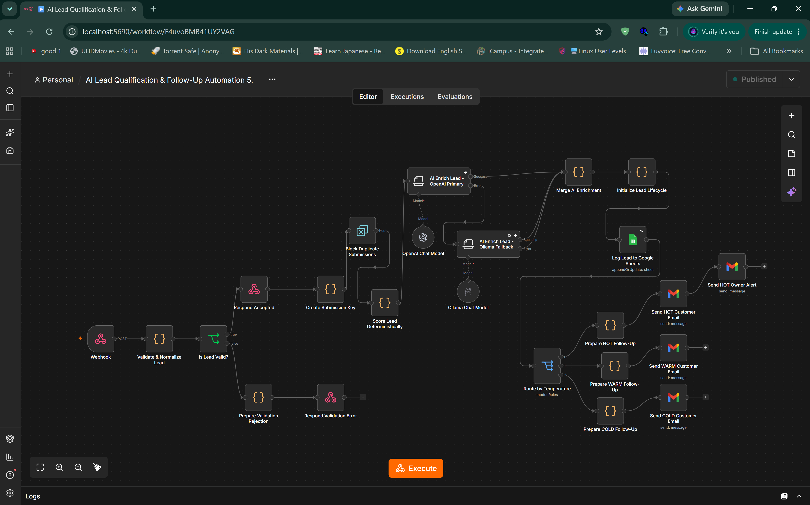
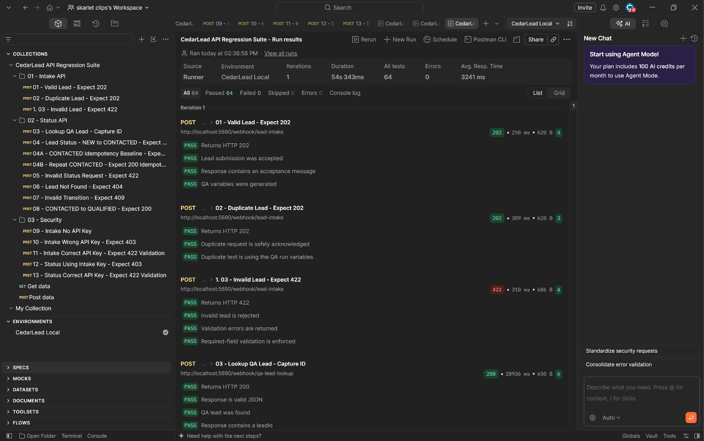

# CedarLead — AI Lead Qualification & CRM Automation

**Validate enquiries. Prioritize leads. Coordinate follow-up.**

[](https://github.com/kwhesikeen/ai-lead-qualification-automation/releases/tag/v2.0.0)


CedarLead is a production-style sales automation project that validates incoming enquiries, prioritizes leads, and coordinates follow-up through deterministic scoring and AI-assisted enrichment.

Built with **n8n**, **Docker**, **Google Sheets**, **Gmail**, **OpenAI**, **Ollama**, and **Postman**, the project combines lead qualification and HOT/WARM/COLD routing with CRM-style lifecycle management, SLA monitoring and escalation, operational reporting, and automated API regression testing.

[View the v2.0.0 release](https://github.com/kwhesikeen/ai-lead-qualification-automation/releases/tag/v2.0.0) · [Explore the architecture](#high-level-architecture) · [See core capabilities](#core-capabilities)

**Last recorded regression run:** 16 requests · 64/64 assertions passed · 0 failures · 0 errors.

## Main Workflow

[](assets/screenshots/main-workflow.png)

Valid submissions receive an early acceptance response after validation. Processing then continues through duplicate filtering, deterministic lead scoring, OpenAI enrichment with an Ollama fallback, Google Sheets logging, and HOT/WARM/COLD customer follow-up. HOT leads also trigger an owner alert.

*Select the workflow image to view it at full size.*

---
## Regression Test Evidence

[](assets/screenshots/regression-results.png)

*Select the results image to view it at full size.*

## Project Goals

CedarLead was designed to solve several common sales-operations problems:

- Leads arriving from multiple sources without consistent validation.

- Manual lead qualification and prioritization.

- Slow response to high-value opportunities.

- Inconsistent follow-up and lifecycle tracking.

- Lack of SLA visibility and escalation.

- Dependence on a single AI provider.

- Limited operational reporting.

- Manual regression testing after workflow changes.

The system converts these into a repeatable, observable automation pipeline.

---

## High-Level Architecture

```text
                    ┌──────────────────────┐
                    │   Lead Submission    │
                    └──────────┬───────────┘
                               │
                               ▼
                    ┌──────────────────────┐
                    │ Secured Intake API   │
                    │   POST /lead-intake  │
                    └──────────┬───────────┘
                               │
                               ▼
                    ┌──────────────────────┐
                    │ Validate & Normalize │
                    └──────────┬───────────┘
                               │
                    ┌──────────┴──────────┐
                    │                     │
                 Invalid                Valid
                    │                     │
                    ▼                     ▼
               HTTP 422          Duplicate Protection
                                          │
                                          ▼
                               Deterministic Lead Scoring
                                          │
                                          ▼
                              AI Enrichment Layer
                               ┌─────────┴─────────┐
                               │                   │
                            OpenAI              Ollama
                            Primary             Fallback
                               └─────────┬─────────┘
                                         │
                                         ▼
                                Lifecycle Initialization
                                         │
                                         ▼
                                 Google Sheets CRM
                                         │
                                         ▼
                                  Temperature Routing
                           ┌─────────────┼─────────────┐
                           │             │             │
                          HOT           WARM          COLD
                           │             │             │
                           ▼             ▼             ▼
                       Customer       Customer       Customer
                        Email          Email          Email
                           │
                           ▼
                       Owner Alert
```

Additional workflows provide lifecycle updates, SLA monitoring, centralized error handling, reporting, QA support, and daily management reporting.

---

## Core Capabilities

### Deterministic Lead Qualification

Lead routing is controlled by deterministic scoring logic rather than AI output.

The scoring layer produces:

```text
leadScore
leadTemperature
scoringVersion
scoredAt
```

Leads are classified as:

```text
HOT
WARM
COLD
```

AI enrichment provides additional context but does **not override the deterministic routing decision**.

This keeps critical business decisions predictable and testable.

---

## Hybrid AI Enrichment

CedarLead uses a hybrid provider design.

```text
OpenAI Primary
      │
      ├── Success → use OpenAI enrichment
      │
      └── Failure → Ollama fallback
                         │
                         ▼
                   Local LLM response
```

The local Ollama service is accessible to the n8n Docker container through:

```text
http://host.docker.internal:11434
```

The local development fallback used during testing was:

```text
qwen2.5:3b-instruct
```

AI enrichment includes fields such as:

```text
aiLeadSummary
aiBusinessNeed
aiPainPoints
aiAutomationOpportunities
aiPurchaseIntent
aiUrgencyAssessment
aiRecommendedSolution
aiSalesTalkingPoints
aiRecommendedNextAction
aiConfidence
aiProvider
aiModel
aiFallbackUsed
aiEnrichmentStatus
```

This architecture allows the automation to continue operating even if the primary hosted AI provider is unavailable.

---

## Lead Lifecycle Management

Each qualified lead receives a unique CedarLead identifier:

```text
CL-YYYYMMDD-XXX
```

Supported lifecycle states are:

```text
NEW
CONTACTED
QUALIFIED
PROPOSAL
WON
LOST
```

Allowed transitions:

```text
NEW
├── CONTACTED
└── LOST
CONTACTED
├── QUALIFIED
└── LOST
QUALIFIED
├── PROPOSAL
└── LOST
PROPOSAL
├── WON
└── LOST
WON  → terminal
LOST → terminal
```

Repeated updates to the same lifecycle state are supported as idempotent operations.

---

## SLA Management

Lead priority is assigned automatically:

```text
HOT  → P1 → 1-hour SLA
WARM → P2 → 24-hour SLA
COLD → P3 → 72-hour SLA
```

The SLA Monitor evaluates active leads and detects overdue work.

Escalation cooldowns prevent repeated alerts from being sent too frequently.

```text
P1 cooldown → 1 hour
P2 cooldown → 6 hours
P3 cooldown → 24 hours
```

Escalation levels increase as repeated SLA breaches occur:

```text
LEVEL_1
LEVEL_2
LEVEL_3
```

---

## API Security

CedarLead uses separate Header Authentication credentials for different API boundaries.

The required HTTP header is:

```text
x-api-key
```

Credentials are separated by responsibility:

```text
Intake API Key
→ /lead-intake
Status API Key
→ /lead-status
QA API Key
→ /qa-lead-lookup
```

This provides privilege separation.

For example, the Intake API credential is deliberately rejected when used against the Status API.

Actual API keys are never stored in this repository.

---

## API Endpoints

### Lead Intake

```http
POST /webhook/lead-intake
```

Purpose:

- Validate incoming leads.

- Normalize data.

- Prevent duplicates.

- Score leads.

- Perform AI enrichment.

- Initialize lifecycle data.

- Log to Google Sheets.

- Trigger customer and owner notifications.

Example successful response:

```json
{
  "success": true,
  "status": "accepted",
  "message": "Your enquiry has been received and is being processed."
}
```

Expected status:

```text
202 Accepted
```

Invalid lead data returns:

```text
422 Unprocessable Entity
```

---

### Lead Status API

```http
POST /webhook/lead-status
```

Purpose:

- Update lifecycle state.

- Validate permitted state transitions.

- Assign owners.

- Schedule follow-ups.

- Support idempotent lifecycle updates.

Example request:

```json
{
  "leadId": "CL-20261101-332",
  "status": "CONTACTED",
  "assignedOwner": "Sales Owner",
  "assignedOwnerEmail": "owner@example.com"
}
```

Typical responses:

```text
200 → status updated
404 → lead not found
409 → invalid lifecycle transition
422 → invalid request
403 → authentication rejected
```

---

### QA Lead Lookup API

```http
POST /webhook/qa-lead-lookup
```

This endpoint supports automated regression testing by locating a QA-generated lead and returning its dynamically generated `leadId`.

It uses a separate QA API credential.

The endpoint performs bounded polling while asynchronous lead processing completes.

Example response:

```json
{
  "success": true,
  "status": "found",
  "leadId": "CL-20261101-332",
  "email": "cedarlead.qa.example@example.com",
  "lifecycleStatus": "NEW"
}
```

The QA Support API is intended for controlled QA environments and should not be exposed as a public production business endpoint.

---

## Operational Monitoring

CedarLead produces operational metrics including:

```text
totalLeads
hotLeads
warmLeads
coldLeads
activeLeads
avgLeadScore
newLeads
contactedLeads
qualifiedLeads
proposalLeads
wonLeads
lostLeads
aiSuccessCount
aiFailureCount
openaiCount
ollamaCount
aiFallbackCount
aiFallbackRatePct
overdueLeads
p1Overdue
p2Overdue
p3Overdue
totalEscalations
```

Historical snapshots are stored in the `Metrics` sheet.

The Google Sheets dashboard contains visualizations for:

- Lead temperature distribution.

- Lifecycle pipeline.

- SLA priority health.

- AI provider usage.

- Operational trends.

---

## Daily Management Reporting

A scheduled workflow reads the metrics history and generates an HTML management email.

The report includes:

- Lead performance.

- Lifecycle pipeline.

- SLA and operational health.

- AI provider health.

- Fallback rate.

- Escalation activity.

- Overall system status.

Reports are delivered automatically through Gmail.

---

## Centralized Error Handling

Production workflows can use:

```text
CedarLead - Production Error Handler
```

The handler:

```text
Catch Workflow Failure
        ↓
Normalize Error Details
        ↓
Send System Failure Alert
```

This keeps system-level failure handling separate from normal business-process validation.

---

## Automated Regression Testing

CedarLead includes a full Postman regression suite covering Intake, Status, and Security behavior.

The complete suite executes:

```text
16 API requests
64 assertions
```

Verified result:

```text
Requests:    16 executed / 0 failed
Assertions:  64 executed / 0 failed
Errors:      0
```

The suite validates:

- Successful lead intake.

- Duplicate protection.

- Required-field validation.

- Dynamic QA lead discovery.

- Dynamic `qaLeadId` capture.

- NEW → CONTACTED lifecycle transition.

- Idempotent CONTACTED updates.

- Follow-up timestamp preservation.

- Invalid status requests.

- Missing leads.

- Invalid lifecycle transitions.

- CONTACTED → QUALIFIED transition.

- Missing API keys.

- Incorrect API keys.

- Credential privilege separation.

- Correct Intake authentication.

- Correct Status authentication.

The same suite has passed through:

```text
Postman Desktop Runner → 64/64
Postman CLI            → 64/64
PowerShell runner      → 64/64
```

---

## Running Regression Tests

Postman CLI is required.

From the repository root:

```powershell
.\scripts\run-regression.ps1
```

The script securely prompts for:

```text
intakeApiKey
statusApiKey
qaApiKey
```

Secrets are loaded only into the current process environment and removed automatically after execution.

A successful run ends with:

```text
=========================================
 CEDARLEAD REGRESSION SUITE PASSED
=========================================
CedarLead runtime secrets cleared.
```

No CedarLead API credentials are hard-coded in the regression script.

---

## Workflow Inventory

The exported n8n workflows are stored under `workflows/`.

```text
01-ai-lead-qualification.json
02-lead-status-api.json
03-sla-monitor-escalation.json
04-production-error-handler.json
05-qa-support-api.json
06-operations-metrics-reporting.json
07-daily-management-report.json
```

### 01 — AI Lead Qualification

Main lead-processing pipeline.

### 02 — Lead Status API

Lifecycle state-management API.

### 03 — SLA Monitor & Escalation

Scheduled overdue-lead detection and escalation.

### 04 — Production Error Handler

Centralized production workflow error handling.

### 05 — QA Support API

Protected QA endpoint supporting regression automation.

### 06 — Operations Metrics & Reporting

Scheduled operational metrics collection and history.

### 07 — Daily Management Report

Daily management email generated from operational metrics.

---

## Repository Structure

```text
ai-lead-qualification-automation/
│
├── assets/
│   ├── architecture/
│   ├── screenshots/
│   └── test-evidence/
│
├── docs/
│   ├── architecture.md
│   ├── api-reference.md
│   ├── deployment.md
│   ├── operations.md
│   ├── security.md
│   ├── setup.md
│   └── testing.md
│
├── local-files/
│   └── .gitkeep
│
├── scripts/
│   └── run-regression.ps1
│
├── workflows/
│   ├── 01-ai-lead-qualification.json
│   ├── 02-lead-status-api.json
│   ├── 03-sla-monitor-escalation.json
│   ├── 04-production-error-handler.json
│   ├── 05-qa-support-api.json
│   ├── 06-operations-metrics-reporting.json
│   └── 07-daily-management-report.json
│
├── .env.example
├── .gitignore
├── docker-compose.yml
├── LICENSE
└── README.md
```

---

## Local Development

### Requirements

Install:

- Docker Desktop

- Git

- n8n-compatible browser

- Postman

- Postman CLI

- Ollama if local AI fallback is required

### Environment

Create a local `.env` file from:

```text
.env.example
```

Example:

```env
GENERIC_TIMEZONE=Africa/Accra
```

Never commit the real `.env`.

### Start n8n

```bash
docker compose up -d
```

Local n8n is bound to:

```text
http://localhost:5690
```

The Docker mapping is:

```text
127.0.0.1:5690 → container port 5678
```

Binding to `127.0.0.1` prevents the local development instance from being directly exposed on all network interfaces.

---

## Importing Workflows

Import the JSON files from the `workflows/` directory into n8n.

Credentials are intentionally not distributed with the repository.

After importing, configure the required credentials for:

- Google Sheets.

- Gmail.

- OpenAI.

- Ollama.

- Intake Header Auth.

- Status Header Auth.

- QA Header Auth.

Also reconnect the production Error Workflow where required.

Do not place credential values directly in exported workflow JSON files.

---

## Google Sheets Data Model

The main workbook contains:

```text
Leads
Metrics
Dashboard
```

`Leads` stores:

- Original lead information.

- Deterministic scoring.

- AI enrichment.

- Lifecycle information.

- SLA information.

- Escalation history.

`Metrics` stores time-series operational snapshots.

`Dashboard` provides management-level reporting and charts.

---

## Engineering Principles Demonstrated

CedarLead demonstrates:

- Workflow automation architecture.

- Deterministic business rules.

- AI-assisted enrichment.

- AI provider fallback.

- API design.

- API authentication.

- Privilege separation.

- Stateful lifecycle management.

- Idempotency.

- SLA monitoring.

- Automated escalation.

- Centralized error handling.

- Dockerized local development.

- Secret hygiene.

- Operational observability.

- Automated regression testing.

- Postman CLI automation.

- Git-based version control.

---

## Security Notes

The repository intentionally excludes:

```text
.env
.vscode/
docker-compose.yml.backup
local runtime files
API credentials
provider secrets
```

The repository should contain configuration templates and credential references only.

Never commit:

- API keys.

- OAuth client secrets.

- passwords.

- access tokens.

- private `.env` files.

- exported credentials.

---

## Current Validation Status

Latest full automated regression result:

```text
16 requests
64 assertions
64 passed
0 failed
0 errors
```

Status:

```text
PASS
```

---

## License

See the `LICENSE` file in this repository.
